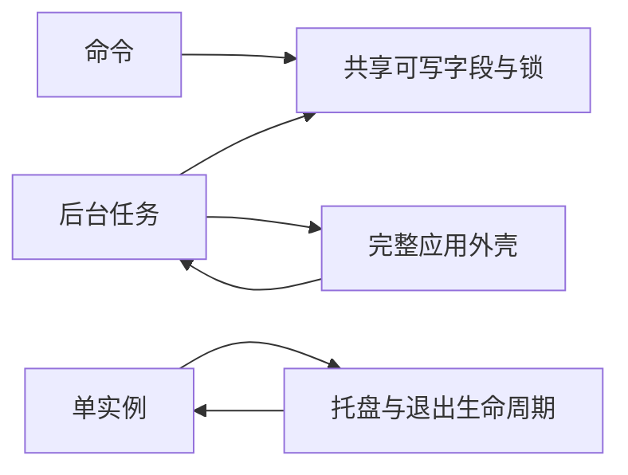
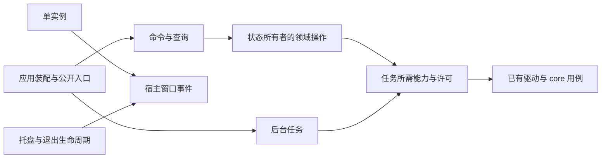

# 状态封装与依赖方向

结构诊断应沿调用方需要的操作寻找边界。先解释数据与行为由谁拥有，再修改依赖和接口；移动文件、增加 getter 或改名本身不能证明边界已经修复。通用约束仍由 [工程规则](../../../../docs/ENGINEERING_RULES.md#2-文件模块与依赖边界) 维护。

本参考适用于已有多调用方共享状态、后台任务或模块依赖的代码。只有出现实际诊断或相关请求时才使用；下文结构是规范示例，不要求项目采用相同目录、类型或运行时。

## 从诊断找到职责

| 信号 | 先追踪什么 | 修复方向 | 不能作为完成依据的改动 |
|---|---|---|---|
| `module-cycle`、`tangle` | 双向依赖各自需要的类型、规则、事件和调用 | 把协议模型、领域约束或宿主事件放到其真实所有者；让高层单向消费低层 | 把双方搬进一个目录，或把依赖统一改到无职责的共享文件 |
| `field-leak` | 外部如何读取、联动修改字段，哪些不变量必须原子成立 | 由状态所有者提供快照、领域操作或有生命周期的任务能力 | 每个字段增加同名 getter，继续返回可写容器或底层锁 |
| `shallow-module` | 接口是否承担独立约束，调用方是否仍须了解内部步骤 | 合并无约束转发层，或把真实用例与不变量收进所有者 | 为降低报告数量增加包装层、通用 callback 或类型擦除 |
| 后台任务依赖完整应用外壳 | 任务实际需要的状态、驱动、取消和完成通知 | 由装配层传入已有状态句柄或任务所需能力 | 复制权威状态，或为每个任务预建一套服务容器 |

例如，请求/响应模型与其标量校验可以由工作流消费，模型层不应反向依赖工作流。单实例和托盘都需要恢复窗口时，窗口事件由宿主窗口模块维护，两者消费该模块；不把宿主机制搬入 core。多个模块确实共用的能力按职责命名，不因需要打断一条依赖边就建立新的层。

## 前后结构示例

调整前：后台任务通过应用外壳绕回自身，调用方直接修改共享状态；两个宿主模块相互借用窗口行为。

调整后：状态操作维护不变量，装配层分配任务能力；窗口事件有独立的宿主所有者。

示例只表达依赖方向。若任务需要共享状态自身提供的多个操作，直接使用已有状态句柄即可，不必再造任务上下文。core、运行时基础设施与宿主的具体分工仍沿真实操作判定，不能把全部状态或 I/O 机械搬到 core。

## 封装状态时保留原有并发语义

- 只读调用方取得值或有界快照；写入通过能够维持跨字段约束的操作完成。需要多字段一致快照时，在同一同步边界读取，不能把原有原子更新拆成一串 setter。
- 区分借用、共享所有权、只读端口和写入许可。已有协调器可作为能力传递；不复制其内部状态，也不让外部直接取得用于维护内部不变量的可写锁。
- 许可按实际操作认领并持有至工作结束，正常返回、拒绝、取消和失败均释放。调用方只持有或释放许可，不取得修改底层锁的能力。
- 同一存储的多个逻辑客户端继续使用原有唯一 writer。调整目录或按客户端拆分任务时，不为每个客户端重建互不协调的 writer。
- 取消信号、任务句柄和退出回收的所有者保持明确。用户取消一项请求不应关闭应用级任务入口；收到取消请求也不能提前声称阻塞工作已经结束。
- 同步锁不跨异步等待；异步锁也须说明互斥范围、获取顺序和取消路径。回调可能重入时，先结束内部借用或锁定，再分发回调。持有许可或异步锁跨等待是否合理，应根据被保护操作判断。

## 按变化选择验证

保留原有公开结果、错误、事件与测试断言，再选择本次受影响的场景：快照一致性、准入失败后许可释放、共享 writer 互斥、等待期间取消、任务失败后的终态、退出等待与重复回收。纯目录或引用调整只做必要的解析和原有相关测试，不按本表自动补齐全部场景。

涉及 Unix socket 等受平台路径长度约束的测试时，为本次测试分配短且独占的临时目录，并保留 socket 名称和失败断言；不要因为长路径夹具失败而跳过该场景或修改生产协议。测试结束后按 [任务收尾清理](../../../../docs/ENGINEERING_RULES.md#54-任务收尾清理) 回收精确目录。

项目已要求或本次明确选择 `deslop-please` 时，按其当前 `--help` 选择实际 crate/module 与配置。官方工具通过目标和 feature 配置决定分析对象，未激活的条件编译代码不在该次结果内；单次零诊断不能证明所有平台、业务语义或运行行为。不要增加 allow 清单或关闭规则来替代已确认问题的修复。工具说明核对于 2026-11-25，见 [官方仓库](https://github.com/deterministic-machines/deslop-please)。

完成时交回实际修复的依赖边、状态不变量、范围内检查结果及未覆盖项。独立问题转回实施入口判定范围，不借结构扫描扩大产品改造。
